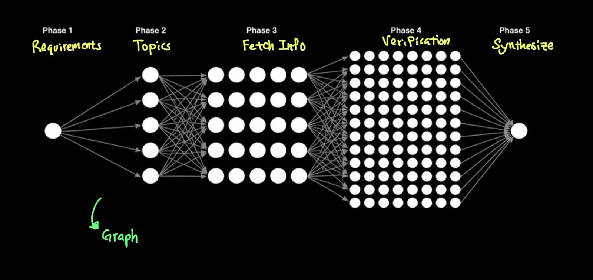

# Graph Engineering explained in 8min..

Source URL: https://www.youtube.com/watch?v=mBePcvqLX88
Creator: Caleb Writes Code
Published: 2026-07-30 (Europe/Stockholm)
Captured: 2026-10-27

Image: a matching frame extracted from the linked video at approximately 3:05. It shows the diagram supplied with the request.

## Main Points

- The video uses a deep-research demonstration to explain agent workflow graphs. One requirements step fans out to topic workers, then information gathering, verification, and a final synthesis step. The drawn flow goes only forward, making this example a directed acyclic graph (DAG).
- Nodes are work units, which may be full agents with their own prompts, tools, and context windows. Edges define how results and control pass between those units. The graph can be generated dynamically for a particular request rather than fixed at design time.
- The claimed benefits are parallel speed and separation of concerns: specialized workers can investigate different topics without one agent carrying every detail in one context window.
- The tradeoff is more coordination and token use. The speaker cites Anthropic's report that its agents used about four times the tokens of chat and its multi-agent system about fifteen times, and estimates the cost of his own demonstration. These numbers are workload-specific examples, not universal prices or performance guarantees.
- The video argues that graph orchestration becomes more useful as individual agent nodes become capable enough to complete substantial tasks. Earlier graph frameworks could already express the structure, but often linked simpler LLM calls or weaker agents.
- The research DAG is an illustration, not a claim that every agent graph must be acyclic or that many agents automatically produce trustworthy verification. The speaker's broad question is how to divide a complex task among capable nodes.

## Source Context

The YouTube description identifies the creator and topic. The main-point capture was checked against the video's automatic captions as mirrored at https://app.frontiernews.tech/videos/1318. The cost comparison is attributed in the video to Anthropic's multi-agent research write-up.

## Notable Links

- Anthropic, How we built our multi-agent research system: https://www.anthropic.com/engineering/multi-agent-research-system
- LangChain, 3 Years of Graph Engineering with LangGraph: https://www.langchain.com/blog/3-years-of-graph-engineering-with-langgraph
