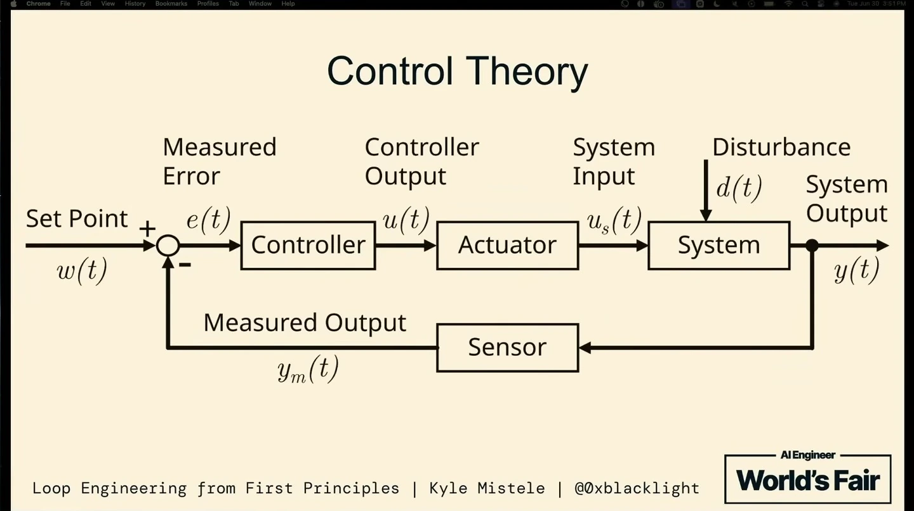

# Loop Engineering from First Principles

Source URL: https://www.youtube.com/watch?v=xIt_mTQp6mY
Transcript and slide source: https://ai.engineer/talks/xIt_mTQp6mY-loop-engineering-from-first-principles
Speaker: Kyle Mistele (HumanLayer)
Event: AI Engineer World's Fair 2026
Captured: 2026-10-27

Image: the control-theory slide supplied with the request, preserved here from the corresponding frame on the official AI Engineer talk page.

## Main Points

- Mistele argues that repeated agent prompting, even with automated reviewers, can produce enormous pull requests that a human team cannot realistically read. For production code, reviewability and human ownership are part of the goal.
- He maps a coding loop to control theory: a desired codebase property is the set point; a sensor detects violations; a controller chooses a small correction; an actuator agent changes the code; CI and review provide feedback; other team changes are disturbances. The system is measured again after each iteration.
- The example is HumanLayer's migration of RPC procedures to Effect. A structural scan with ast-grep identifies unmigrated procedures. The results are normalized and sorted so the controller can choose a small target, potentially the smallest procedure. Mistele favors deterministic code for deterministic selection.
- Before reducing the existing backlog, the team records a baseline of violations on `main` and rejects new unmigrated procedures in PRs. This prevents new work from undoing the loop's progress.
- The actuator is a CLI coding agent given the selected target, a skill, and hand-written golden examples showing the repository's preferred implementation. Conventional automation commits its result and opens the PR. A CI workflow can run one loop iteration on a schedule.
- The initial workflow was difficult to steer, so the proposed correction path uses a version-controlled Markdown feedback file. An `/iterate` review comment lets the workflow revise the PR and update reusable guidance for future runs.
- Each loop labels its PRs and checks for an earlier open PR with the same label before starting new work. If one exists, the run stops. This backpressure limits generated work to what reviewers can absorb and reduces duplicate or conflicting changes.
- Larger batches or multiple reviewer-owned workflows can raise throughput later, but review capacity remains the limiting resource. The talk offers a design and example, not a measured comparison against other development workflows.

## Notable Follow-up Links

- HumanLayer's published agent skills: https://github.com/humanlayer/skills
- ast-grep rule documentation: https://ast-grep.github.io/guide/rule-config.html
